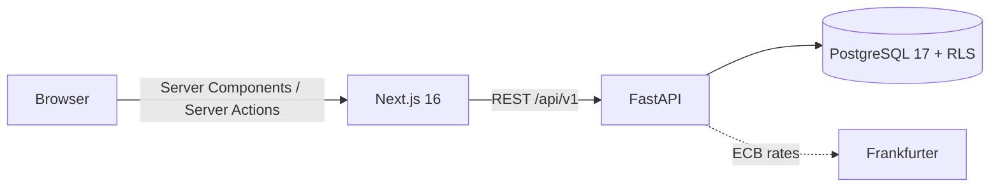

# FreightSight

Landed cost allocation and container tracking for SMB importers.

[](https://github.com/Pchambet/FreightSight/actions/workflows/ci.yml)


**Status: pre-alpha, design partners only.** The sections below say exactly what works, what is
manual, and what is planned.

## The problem

SMB importers price on FOB and discover their real cost per purchase order 30 to 60 days later, once the
forwarder, customs and demurrage invoices have landed. Spreadsheets allocate freight pro rata of value,
which is wrong for anything bulky, and nobody reconciles one invoice against three containers and five POs.

FreightSight allocates logistics costs across purchase orders, lines and containers with an auditable
method, and will track containers and read invoices so the number is right before the last invoice arrives.

## What works today

- **Purchase orders with lines** (SKU, quantity, unit price, weight, volume, HS code, duty rate), in any
  currency with a fixed FX rate, and **containers loaded with a quantity of each line**. A PO can be split
  across containers; a container can carry several POs.
- **Costs with one scope** (shipment, container, PO or PO line) that cascade down to the loaded lines:
  ocean freight, THC, insurance, customs duty, drayage, demurrage and more. Each cost is stored in its
  invoice currency with the ECB rate fixed at the invoice date (or a manual rate).
- **Allocation engine**: by value, weight, volume, quantity or manual percentages, in Decimal with a
  largest-remainder split so the parts always sum to the cost. Customs duty is allocated in a second pass on
  the CIF basis (by theoretical duty when every line has a duty rate). Import VAT is tracked for the cash
  view and excluded from the landed cost. Anything that cannot be allocated is reported, never guessed.
- **Landed cost per PO line with unit cost**, per container, shipment or purchase order, plus a live
  "what if" preview that switches the method per cost type without saving.
- **Import wizard**: upload a CSV or XLSX, map the columns (remembered per file layout), get a dry-run
  validation report with row-level errors, then commit. Excel FR exports (BOM, `;`, `12 500,50`, accents)
  and cp1252 files are handled. Re-importing the same file is a no-op.
- **Manual tracking**: milestone, discharge date, free days; the last free day and demurrage risk are
  derived from them.
- **Authentication and tenancy**: Clerk sign-in with mandatory organizations; the Next app sends the
  user's session token to the API, which verifies it against Clerk's JWKS, mirrors user, organization
  and membership locally, and scopes every query to that organization. Postgres Row Level Security
  enforces the scope a second time. In development only (`APP_ENV=dev`), an `X-Org-Id` header can stand
  in for a token; production refuses to start without Clerk configuration.

## What is manual or missing

| Area | State |
|---|---|
| Container tracking from carriers / terminals (events, ETA, last free day) | Manual entry only. Provider abstraction planned in Phase 2. |
| Invoice extraction (PDF → cost lines with review) | Not built. Planned in Phase 2. |
| Invitations and role management inside the app | Handled in Clerk's own components for now (organization switcher, user button). |
| Alerts, e-mail, background jobs | Not built. |
| ERP connectors (Odoo, Pennylane), exports | Not built. Phase 3. |

## Architecture



- `backend/app/domain/costing/engine.py` is a pure function: engine inputs in, allocations out, no I/O.
  `service.py` materialises the result per organization in the same transaction as any write.
- `backend/app/core/tenancy.py` sets the `app.org_id` session variable read by every RLS policy.
- `frontend/src/lib/api/client.ts` is a typed `openapi-fetch` client generated from the backend OpenAPI.
  The browser never calls the API directly.

## Getting started

Prerequisites: Docker, Node 22+, [uv](https://docs.astral.sh/uv/).

```bash
git clone https://github.com/Pchambet/FreightSight.git && cd FreightSight

# Backend + Postgres (migrations run automatically)
docker compose up -d --build
# API on http://localhost:8001, Swagger on http://localhost:8001/docs

# Frontend: needs a Clerk development instance (free) with Organizations enabled
cd frontend
cat > .env.local <<'EOF'
API_URL=http://localhost:8001
NEXT_PUBLIC_CLERK_PUBLISHABLE_KEY=pk_test_...
CLERK_SECRET_KEY=sk_test_...
NEXT_PUBLIC_CLERK_SIGN_IN_URL=/sign-in
NEXT_PUBLIC_CLERK_SIGN_UP_URL=/sign-up
EOF
npm install
npm run dev                     # http://localhost:3000
```

For the local API to accept those sessions, put `CLERK_ISSUER` and `CLERK_JWKS_URL` in a repo-root `.env`
(see `.env.example`); docker compose passes them to the API. Deployment notes: `docs/04_ops_railway_vercel.md`.

Try it: Imports → New import → upload `backend/tests/fixtures/legacy_po_container.csv`, then open a
container, add an ocean freight cost, and switch the allocation method in the preview.

## Development

```bash
cd backend
uv sync --all-groups
uv run pytest            # throwaway Postgres via testcontainers; 47 tests incl. RLS, JWT and tenancy
uv run ruff check . && uv run ruff format --check . && uv run mypy .
uv run alembic revision --autogenerate -m "describe change"

cd ../frontend
npm run api:types        # regenerate src/lib/api/schema.d.ts after an API change
npm run typecheck && npm run lint && npm run build
```

Production must connect to Postgres as the non-superuser role `freightsight_app` created by migration
0003, otherwise Row Level Security is bypassed. CI runs the same commands against a Postgres 17 service.

## License

MIT, see [LICENSE](LICENSE).
