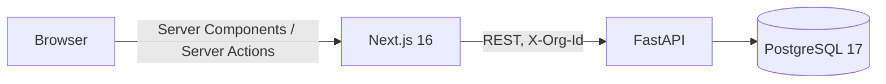

# FreightSight

Landed cost allocation and container tracking for SMB importers.

[](https://github.com/Pchambet/FreightSight/actions/workflows/ci.yml)


**Status: pre-alpha, design partners only.** This is not a product yet. The sections below say exactly
what works, what is simulated, and what is planned.

## The problem

SMB importers price on FOB and discover their real cost per purchase order 30 to 60 days later, once the
forwarder, customs and demurrage invoices have landed. Spreadsheets allocate freight pro rata of value,
which is wrong for anything bulky, and nobody reconciles one invoice against three containers and five POs.

FreightSight allocates logistics costs across purchase orders and containers with an auditable method,
and will track containers and read invoices so the number is right before the last invoice arrives.

## What works today

- Import purchase orders from CSV (Excel FR exports with BOM, `;` and `12 500,50` are handled), with
  per-row error reporting and idempotent re-import.
- Create containers, link them to POs, set their status manually.
- Record logistics costs (ocean freight, customs, drayage, demurrage) in the organization's base currency.
- Compute the landed cost per PO for a container: pro rata of PO value, rounded to the cent with a
  largest-remainder split so the parts always sum to the total. Legacy percentages are honoured only if
  they sum to exactly 100 %; otherwise the API says so in `warnings` instead of guessing.
- Money is `Decimal` end to end and serialised as strings; a test fails if a float sneaks in.
- Tenancy is scoped by an `X-Org-Id` header. This is a placeholder for real authentication.

## What is simulated or missing

| Area | State |
|---|---|
| Container tracking (carrier / terminal events, ETA, last free day) | Not built. Status is set by hand. Provider abstraction planned in Phase 2. |
| Invoice extraction (PDF → cost lines) | Not built. The endpoint returns `501 NOT_IMPLEMENTED`. LLM extraction with human review planned in Phase 2. |
| Authentication, users, roles | Not built. `X-Org-Id` header only. Planned in Phase 1. |
| Multi-currency costs with fixed FX rates | Not built. A cost must be in the org's base currency. Planned in Phase 1. |
| Allocation by weight, volume, quantity, per-line SKU costing | Not built. Planned in Phase 1. |
| Background jobs, alerts, e-mail | Not built. |

## Architecture



- `backend/` FastAPI, SQLAlchemy 2, Alembic, pydantic v2, `uv`. Pure allocation engine in `app/costing.py`.
- `frontend/` Next.js 16 App Router, Tailwind 4, typed API client generated from the backend OpenAPI.

## Getting started

Prerequisites: Docker, Node 22+, [uv](https://docs.astral.sh/uv/).

```bash
git clone https://github.com/Pchambet/FreightSight.git && cd FreightSight

# Backend + Postgres (migrations run automatically)
docker compose up -d --build
# API on http://localhost:8001, Swagger on http://localhost:8001/docs

# Frontend
cd frontend
cp ../.env.example .env.local   # keep API_URL and ORG_ID, drop the backend lines
npm install
npm run dev                     # http://localhost:3000
```

Try it: import `backend/tests/fixtures/legacy_po_container.csv` from the home page, open a container,
add a cost, read the breakdown.

## Development

```bash
cd backend
uv sync --all-groups
uv run pytest            # spins up a throwaway Postgres via testcontainers
uv run ruff check . && uv run ruff format --check . && uv run mypy .
uv run alembic revision --autogenerate -m "describe change"

cd ../frontend
npm run api:types        # regenerate src/lib/api/schema.d.ts after an API change
npm run typecheck && npm run lint && npm run build
```

CI runs the same commands against a Postgres 17 service. Install `pre-commit` to get gitleaks and ruff
on every commit.

## License

MIT, see [LICENSE](LICENSE).
