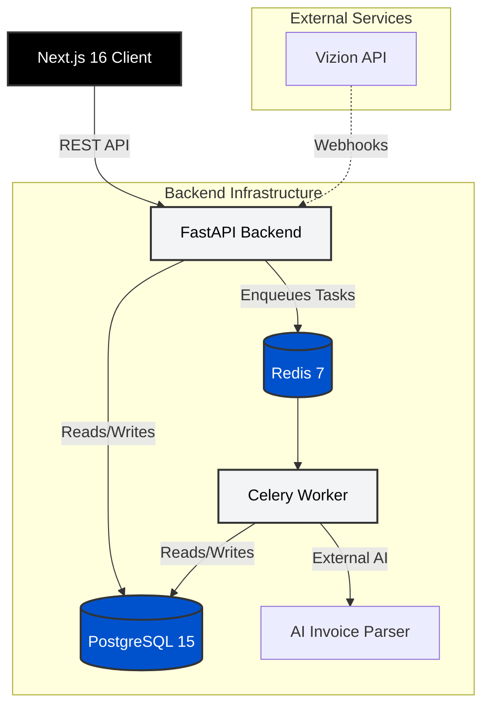
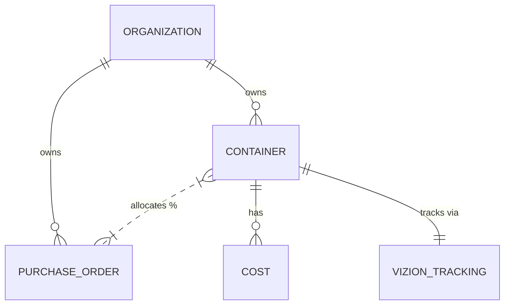

<div align="center">

# FreightSight 🚢

**The OS for Global Freight Intelligence.** <br/>
Calculate *true landed costs* and track containers in real time. Built for SMB Importers.

[](https://github.com/Pchambet/FreightSight/actions)
[](https://opensource.org/licenses/MIT)
[]()
[]()
[]()

[Explore Docs](#getting-started) · [Report Bug](https://github.com/Pchambet/FreightSight/issues) · [Request Feature](https://github.com/Pchambet/FreightSight/issues)

</div>

---

## ⚡ The FreightSight Advantage

SMB importers lose **2-5% of margin** because they rely on manual spreadsheets to understand their true landed costs, often discovering them 30-45 days after goods arrive. 

FreightSight automatically allocates freight, customs, drayage, and demurrage costs across Purchase Orders (POs) — **in real time**, as your containers move across the ocean. Stop pricing products based on FOB values; start pricing on fully-burdened costs.

## ✨ Features

- **🚢 Real-Time Container Tracking** — Integrated with Vizion API for webhook-driven, real-time status updates. Never miss a demurrage deadline.
- **💰 Dynamic Landed Cost Engine** — Automatic cost allocation across POs using highly configurable percentages. Perfect for split shipments.
- **🤖 AI Invoice Parsing** — Drop a PDF freight invoice and let our AI engine automatically extract the costs using advanced OCR.
- **📦 Seamless CSV Ingestion** — Bulk import Purchase Orders with container-to-PO allocation mappings in seconds.
- **📊 Control Tower Dashboard** — A beautiful, intuitive bird's-eye view of all active shipments and their financial impact.

## 🏗️ Architecture



## 🚀 Getting Started

We recommend using Docker Compose to spin up the backend services easily. 

### Prerequisites
- Docker & Docker Compose
- Node.js 20+

### 1. Clone the repository
```bash
git clone https://github.com/Pchambet/FreightSight.git
cd FreightSight
```

### 2. Start the Backend Infrastructure
Spin up the API, PostgreSQL, Redis, and Celery workers:
```bash
docker compose up -d --build
```
> The API will be available at [http://localhost:8001](http://localhost:8001). Check out the Swagger docs at [http://localhost:8001/docs](http://localhost:8001/docs).

### 3. Start the Frontend Application
In a new terminal window:
```bash
cd frontend
npm install
npm run dev
```
> The application will be running at [http://localhost:3000](http://localhost:3000).

## 🗄️ Core Data Model

The key innovation of FreightSight is the **Many-to-Many** relationship between Containers and POs, enabling precise cost proration.



## 📖 Strategy & Documentation

All strategic documents are located in the [`/docs`](./docs) directory:

- 📑 **[01 — Audit & Skok Framework](./docs/01_audit_skok_framework.md)** — Strategic product audit using Michael Skok's 4Us and BLAC & White frameworks.
- 🎯 **[02 — Go-To-Market Strategy](./docs/02_gtm_strategy.md)** — Target personas, outreach templates, competitive analysis, and pricing strategies.
- 💻 **[03 — Technical Walkthrough](./docs/03_technical_walkthrough.md)** — Deep dive into the architecture, core files, API endpoints, and test strategies.

## 📄 License

This project is licensed under the MIT License - see the [LICENSE](LICENSE) file for details.
