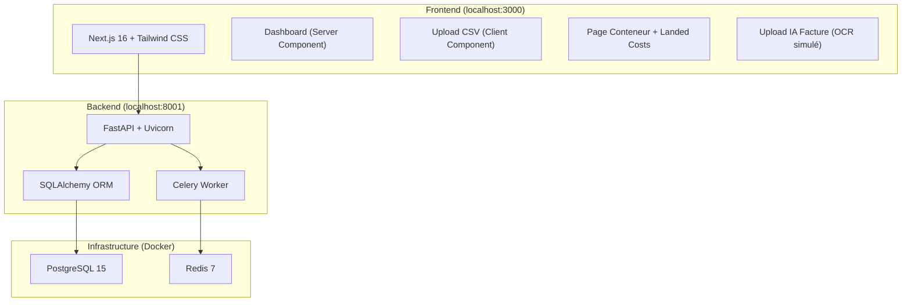

# FreightSight MVP — Walkthrough Final

## Résumé du Projet

**Origine :** Un ancien module Odoo mal architecturé (`legacy_odoo_module`) a été audité, disséqué, et transformé en un SaaS Cloud standalone dédié au suivi de conteneurs maritimes et au calcul des Landed Costs pour les PME importatrices.

**Framework stratégique :** La décision de pivoter vers ce produit a été validée via le framework de Michael Skok (4Us / BLAC & White) — le problème des Landed Costs est le seul qui soit à la fois **Blatant**, **Critical**, et **Unworkable** pour les PME.

---

## Architecture Technique

---

## Fichiers Créés

### Backend (`/freightsight_mvp/backend/`)
| Fichier | Rôle |
|---|---|
| [main.py](file:///Users/pierre/Desktop/timeo%20-%20boat/freightsight_mvp/backend/main.py) | API FastAPI : 7 endpoints (CRUD conteneurs, upload CSV, landed costs, OCR, webhook) |
| [models.py](file:///Users/pierre/Desktop/timeo%20-%20boat/freightsight_mvp/backend/models.py) | Modèles SQLAlchemy : Organization, PurchaseOrder, Container, ContainerPurchaseOrder (M2M), Cost, VizionTrackingMetadata |
| [schemas.py](file:///Users/pierre/Desktop/timeo%20-%20boat/freightsight_mvp/backend/schemas.py) | Schémas Pydantic : validation stricte des entrées/sorties |
| [database.py](file:///Users/pierre/Desktop/timeo%20-%20boat/freightsight_mvp/backend/database.py) | Configuration SQLAlchemy + session factory |
| [tasks.py](file:///Users/pierre/Desktop/timeo%20-%20boat/freightsight_mvp/backend/tasks.py) | Workers Celery pour les tâches asynchrones |

### Frontend (`/freightsight_mvp/frontend/src/`)
| Fichier | Rôle |
|---|---|
| [page.tsx](file:///Users/pierre/Desktop/timeo%20-%20boat/freightsight_mvp/frontend/src/app/page.tsx) | Dashboard principal — tableau des conteneurs actifs |
| [UploadCSV.tsx](file:///Users/pierre/Desktop/timeo%20-%20boat/freightsight_mvp/frontend/src/components/UploadCSV.tsx) | Drag & Drop CSV avec notifications toast |
| [container/[id]/page.tsx](file:///Users/pierre/Desktop/timeo%20-%20boat/freightsight_mvp/frontend/src/app/container/%5Bid%5D/page.tsx) | Page détaillée Landed Costs par conteneur |
| [AddCostForm.tsx](file:///Users/pierre/Desktop/timeo%20-%20boat/freightsight_mvp/frontend/src/app/container/%5Bid%5D/AddCostForm.tsx) | Formulaire d'ajout de coût manuel |
| [AIInvoiceUpload.tsx](file:///Users/pierre/Desktop/timeo%20-%20boat/freightsight_mvp/frontend/src/app/container/%5Bid%5D/AIInvoiceUpload.tsx) | Upload de facture PDF avec extraction IA simulée |

### Infra
| Fichier | Rôle |
|---|---|
| [docker-compose.yml](file:///Users/pierre/Desktop/timeo%20-%20boat/freightsight_mvp/docker-compose.yml) | Orchestre PostgreSQL, Redis, Backend, Celery |
| [test_data.csv](file:///Users/pierre/Desktop/timeo%20-%20boat/freightsight_mvp/test_data.csv) | Données de test (3 POs, 2 conteneurs) |

---

## Endpoints API

| Méthode | Route | Description | Testé |
|---|---|---|---|
| GET | `/` | Health check | ✅ |
| GET | `/api/containers` | Liste tous les conteneurs | ✅ |
| POST | `/api/containers` | Crée un conteneur + souscrit Vizion | ✅ |
| POST | `/api/purchase-orders/upload` | Ingestion CSV de bons de commande | ✅ |
| POST | `/api/containers/{id}/costs` | Ajoute un coût à un conteneur | ✅ |
| GET | `/api/containers/{id}/landed-costs` | Calcule les landed costs ventilés par PO | ✅ |
| POST | `/api/containers/{id}/upload-invoice` | Upload facture + extraction IA simulée | ✅ |
| POST | `/api/webhooks/vizion` | Webhook pour les events Vizion API | ✅ |

---

## Tests Validés

### Base de données
- 1 Organisation créée automatiquement
- 3 Bons de Commande (Michelin, Pirelli, Hankook)
- 2 Conteneurs (MSCU1234567, CMAU9876543)
- 3 Liens M2M avec pourcentages d'allocation (100%, 50%, 100%)
- 4 Coûts enregistrés (Ocean Freight x2, Customs, Drayage)
- Calcul Landed Cost vérifié : Michelin = 14 900.50$, Pirelli = 9 600.00$

### Infrastructure
- 4 conteneurs Docker en état `Running`
- Backend API sur port 8001
- Frontend Next.js sur port 3000
- PostgreSQL sur port 5432
- Redis sur port 6379

---

## Prochaines Étapes

> [!IMPORTANT]
> **Priorité n°1 : Valider le marché.** Le MVP est fonctionnel. Ne plus coder avant d'avoir parlé à 5 vrais prospects.

Voir le document [gtm_strategy.md](file:///Users/pierre/.gemini/antigravity/brain/c60b295f-3226-4ff0-ac3b-13d779b8c330/gtm_strategy.md) pour le plan d'action commercial complet.

### Roadmap Technique (après validation marché)
1. **Phase 1** : Remplacer l'OCR simulé par une vraie extraction via LLM (OpenAI Vision API)
2. **Phase 2** : Connecteurs ERP (QuickBooks, NetSuite)
3. **Phase 3** : Alertes prédictives de surestaries (Demurrage & Detention)
